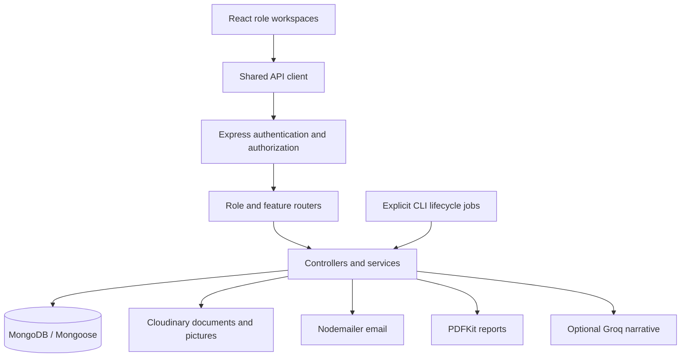

# SOCConsult / ConsultIO — System Audit and Development Handoff

Prepared: 23 November 2026, Asia/Manila.

This document preserves the previously completed read-only audit. It is a technical handoff for an assistant that has not inspected the repository. It does not authorize implementation. No application source, configuration, dependencies, database records, commits, or deployments were changed during preparation of this report.

**Exact audited commit:** `be21335032e95869ff735a5de3a56095bc1dc46c` (`origin/dev` at the audit fetch).

**Evidence convention:** Unless explicitly stated otherwise, source paths and line numbers refer to that commit, not the older active local checkout. Line numbers are navigation anchors and can shift in future versions. “Confirmed” generally means a clear code-level defect; browser or real-service reproduction is identified separately. Source presence is not proof of runtime success.

**Development scope:** Stabilize and polish the existing application, especially Dean management. Preserve working Student/Faculty behavior. Do not rebuild the application or combine unrelated fixes into broad refactors.

# 1. Executive Summary

SOCConsult is a substantial MERN consultation-management application for Holy Angel University. It has connected Student, Faculty, and Dean workflows, a shared personal consultation workspace for the Dean, defensive management mutations, and a significant isolated test suite. Its implementation is more complete than some historical README sections imply.

The current developer primarily handles Dean management; Krisdane primarily handles Faculty development according to the supplied project context. These responsibilities are contextual agreements, not repository-enforced ownership verified by the audit.

The best direction is incremental stabilization: repair actual workflow inconsistencies, harden credentials/sessions/document delivery, verify real database and browser behavior, and gradually standardize existing UI patterns. No new design framework or wholesale rewrite is justified.

| Major finding | Assessment |
| --- | --- |
| Original Git repository | Three corrupt/missing blob objects; detached audit worktree could not be created |
| Dean attendance-outcome reports | Confirmed filter defect excludes current initiator-reported outcomes |
| Dean attendance proof | Confirmed integration defect routes management proof through participant-only authorization |
| Account passwords | Initial and reset passwords equal institutional IDs without enforced replacement |
| Sessions | Issued JWTs survive logout and password changes/resets until expiry |
| Document privacy | Upload configuration uses public-default Cloudinary delivery; deployed restrictions remain unverified |
| Personal Faculty/Dean PDF UI | Development StrictMode lifecycle defect suppresses feedback and busy reset |
| Legacy eligibility | Login, discovery, booking, approval, and reset disagree on null/missing registration state |
| Automated validation | 516 tests passed; frontend build passed; formatting check failed on 248 files |
| Operational readiness | Real transactions, deployed indexes, storage restrictions, SMTP, scheduler, and browser usability unverified |

The application is suitable for isolated functional testing. Academic demonstration is conditional on targeted fixes and a seeded rehearsal. Real institutional use should wait for the security and operational gates documented below.

# 2. Repository and Git Status

## 2.1 Verified references

The original audit fetched the verified remote `https://github.com/HAUSOCCODE/SOCConsult.git`. Preparing this handoff rechecked local status and stored references only; it did not fetch again. Therefore “latest remote” below means latest successfully fetched during the original audit, not a guarantee against subsequent GitHub changes.

| Item | Verified value |
| --- | --- |
| Active repository | `D:\Downloads\SOCConsult` |
| Historical path in request | `D:\PersonalProjects\SOCConsult` — not the active workspace |
| Active branch | `dev` |
| Active local HEAD | `8dfbff2c391734bef0da20f5d2bca838c6e3ca9a` |
| Fetched `origin/dev` / audited commit | `be21335032e95869ff735a5de3a56095bc1dc46c` |
| Fetched `origin/main` | `27f9ef8116f6865fa22a58924c62fc0aa100d1d6` |
| Local `main` | `e9db08a` at original inspection |
| Local `dev` versus `origin/dev` | 0 ahead, 6 behind; not diverged |
| Active-tree status before report creation | Clean; no tracked changes or non-ignored untracked files reported |
| Local/remote branches | Local `dev`, `main`; remote `origin/dev`, `origin/main`; origin HEAD points to main |
| Fetched main/dev relationship | Dev is an ancestor of main; main has five additional merge commits; source diff is empty |

Ignored environment files and local logs exist; a clean Git status does not establish their absence. This report is the only intended new file from the handoff task.

Recent development history at fetch:

```text
be21335 Merge PR #72: date-only approval/availability fixes
ad5daef Consultation approval, Student outcomes, preferred scheduling
f345187 Merge PR #70: date-only consultation requests
a660a25 Date-only consultation requests and approval workflows
d944733 Merge PR #68: Faculty consultation approval
be15c77 Faculty approval/rejection validation
8dfbff2 Original local HEAD
```

Local-to-remote development changes span 20 files, with 464 insertions and 126 deletions. They primarily affect request forms, one-time schedule approval, Student outcome UI, Appointment validation, transition/notification services, and related tests.

## 2.2 Integrity failure and audit fallback

The fetch updated remote references, but automatic Git maintenance reported corrupt objects. A detached temporary worktree creation failed. The audit did not repair or delete objects, remove worktrees, or alter the active branch.

`git fsck --full --no-reflogs` returned exit code **3**, reporting corrupt/missing blobs:

```text
09e209efebf9e22bf353c37b6c9db657ecd581b0
76c58de707b7f68071a19397efc4f83bc9e3a459
aab559acda81de69f19a209e34830f23a45ab66d
```

A fresh temporary clone of `dev` succeeded and matched the audited SHA:

```text
C:\Users\Mikko\AppData\Local\Temp\socconsult-audit-clone-250feae884124662b3d6ea05f9874253
```

The full source audit and tests used this clone. Its continued existence is not guaranteed: it is a temporary audit artifact, not the recommended permanent development checkout.

## 2.3 Safe synchronization recommendation

1. Preserve the original repository, local-only work, and ignored configuration before recovery.
2. Prefer a verified-unused sibling development clone, or perform separately reviewed Git recovery. Do not delete corrupt objects speculatively.
3. Check local-only branches/commits before retiring the original repository. Do not assume that an apparently clean tree means all valuable work is on origin.
4. In the healthy checkout, fetch and compare references again.
5. If development remains only behind, synchronize with a fast-forward update; do not merge/rebase unnecessarily.
6. Create a focused branch from current `dev`, with a PR targeting `dev`.
7. Treat `main` as release-oriented. History shows PR merges, but branch-protection settings were not inspected.

No pull, reset, clean, merge, rebase, stash, commit, or push was performed.

# 3. Current System Architecture

## 3.1 Technology and versions

The frontend is JavaScript/JSX React with Vite and Tailwind; the backend is Express with Mongoose/MongoDB. The following are lockfile-resolved versions unless a manifest range is explicitly labeled.

| Frontend / tooling | Version | Backend | Version |
| --- | --- | --- | --- |
| React / React DOM | 19.2.8 | Express | 5.2.1 |
| React Router DOM | 7.18.2 | Mongoose | 8.24.2 |
| Vite | 6.4.3 | bcryptjs | 3.0.3 |
| Vite React plugin | 4.7.0 | jsonwebtoken | 9.0.3 |
| Lucide React | 0.511.0 | Multer | 2.2.0 |
| Tailwind | Manifest range `^3.4.17` | Cloudinary | 2.10.0 |
| Root formatter | Prettier, manifest `^3.9.6` | csv-parse | 7.0.3 |
| Root development orchestration | concurrently | Nodemailer | 10.1.4 |
| Styling support | PostCSS / Autoprefixer | PDFKit | 0.20.2 |
| | | Groq SDK | 1.5.0 |
| | | Helmet | 8.3.0 |
| | | express-rate-limit | 7.5.1 |
| | | cors | 2.8.6 |
| | | dotenv | 16.6.1 |

No charting library, separate state-management framework, component library, or animation framework was identified. Do not introduce one simply to standardize existing components.

## 3.2 Directories and entry points

```text
SOCConsult/
  package.json                 # concurrently, build/start, format/check
  README.md                    # mixed current setup and historical task prose
  client/
    package.json
    vite.config.js
    tailwind.config.js
    vercel.json                # SPA rewrite
    public/templates/          # account-import sample CSV
    src/
      main.jsx                 # StrictMode, Router, Toast/Auth providers
      App.jsx                  # public and nested role routing
      api/apiClient.js
      context/                 # AuthContext, ToastContext
      layouts/                 # Student, Faculty, Dean
      pages/{Auth,Public,Student,Faculty,Dean}/
      components/              # shared and feature-specific UI
      hooks/useDialogFocus.js
      utils/                   # dates, names, status, safe errors, Dean routing
      index.css
  server/
    api/index.js               # Vercel request handler
    src/
      server.js                # local server entry
      app.js                   # middleware/router composition
      config/                  # env, DB, workflow policy, import fields
      routes/
      controllers/
      services/
      middleware/
      models/
      assets/fonts/            # PDF font and license
    scripts/                   # isolated tests, migrations, lifecycle jobs
    test/                      # node:test + HTTP/model/UI harnesses
    vercel.json
    ACCOUNT_IMPORT.md
    MANUAL_ACCOUNTS.md
    DEA*.md / FAC*.md / CORE*.md
```

No applicable `AGENTS.md` was found in the audit. Future agents should still check for newly added instructions before implementation.

## 3.3 Frontend structure

- `main.jsx` wraps the app in React StrictMode, BrowserRouter, ToastProvider, and AuthProvider.
- `App.jsx` defines nested role routes and compatibility redirects.
- `ProtectedRoute.jsx` gates frontend navigation; backend authorization remains authoritative.
- StudentLayout, FacultyLayout, and DeanLayout build on `components/RoleLayout.jsx`.
- Authentication and toast state use React contexts; feature state mostly uses component hooks.
- Shared UI includes `UI.jsx`, `ResponsiveTable.jsx`, `Pagination.jsx`, `ConfirmDialog.jsx`, `PageErrorBoundary.jsx`, and the dialog-focus hook.
- Shared `apiClient.js` handles Bearer authorization, JSON/error parsing, session-expiry events, and downloads. Some audit/document fetch paths duplicate this behavior.
- Tailwind and `index.css` define maroon/gold colors, Inter/system typography, fields, buttons, panels, focus states, and responsive utilities.

## 3.4 Backend and API organization

`server/src/app.js` applies account no-store middleware, Helmet, configured-origin CORS, JSON body limits, feature routers, not-found handling, and error handling.

Mounted API namespaces:

```text
/api/auth
/api/dashboard
/api/dean
/api/availability
/api/appointments             # attendance + appointment routers
/api/schedule-requests
/api/notifications
/api/public
/api/tasks
/api/faculty
/api/student-availability
/api/calendar
```

The backend generally uses routes → controllers → services → Mongoose models. Some appointment and schedule routes still contain substantial validation/orchestration directly. Extract only when doing so improves a concrete workflow or test boundary.

## 3.5 Models

- **User:** identity, role, institutional IDs, account/legacy registration state, profile, password timestamps, scheduling revision.
- **Availability / StudentAvailability:** published provider schedules and Student availability.
- **Appointment:** participants, booking method, current/proposed schedules, request preferences, status/history, documents, private attendance state.
- **OneTimeScheduleHold:** scheduling reservation coordination.
- **SupportingDocument:** legacy document records; newer documents can be embedded storage metadata.
- **AttendanceResponse / AttendanceReview:** participant outcome/proof and management resolution.
- **ConsultationRecord:** professional notes/recommendations.
- **Notification / AuditLog:** role events, history, and management audit.
- **AccountImport:** owner-scoped preview/processing/result records.
- **ReportExport / ReportNarrative / ReportNarrativeReview:** report generation and narrative provenance/review.
- **Task:** backend follow-up action items without an identified current frontend workflow.

## 3.6 Authentication and data flow

Roles are exactly `student`, `faculty`, and `dean`. Dean is not a separate Admin role in current routing/model definitions. Historical Admin migration and aliases are documented.

- Login validates the requested portal against the stored database role and current account eligibility.
- JWTs contain a subject and expire after eight hours.
- Browser tokens are stored in sessionStorage; AuthContext removes the legacy persistent token entry.
- Authentication middleware looks up the current database User for every request and checks account status, role, and registration eligibility.
- Dean management can read school-wide consultations, while personal `/appointments/*` workflows normally require participant ownership.
- Dean can use `/dean/faculty/*` and compatible `/faculty/*` routes without changing role.



# 4. Existing Feature Inventory

## 4.1 Classification

- **IMPLEMENTED:** connected end-to-end source exists; runtime execution may remain unverified.
- **PARTIAL:** backend/UI/operations or integration is incomplete.
- **PLACEHOLDER:** scaffolding or temporary content only.
- **BROKEN:** clear code defect or reproduced failure in the stated conditions.
- **UNVERIFIED:** evidence is insufficient for successful behavior.
- **NOT FOUND:** no implementation identified after reasonable investigation; not necessarily a requirement.

## 4.2 Shared and authentication features

| Feature | Status | Frontend / endpoint / backend / models | Errors and test evidence |
| --- | --- | --- | --- |
| Role login | IMPLEMENTED, security weaknesses | `pages/Auth/*Login.jsx` → `POST /api/auth/login/:role` → `authController.js` → User/bcrypt/JWT | Role tests; Student unknown-email response differs |
| Session restoration | IMPLEMENTED | AuthContext → `GET /auth/me`; `middleware/auth.js` checks current user | Session-expiry handling and auth tests |
| Logout | IMPLEMENTED with revocation limitation | `POST /auth/logout`; audit plus local storage clearing | Issued token remains valid |
| Password change | IMPLEMENTED with byte-limit gap | `PUT /auth/change-password` → auth controller → User/audit transaction | Account/security tests |
| Administrative reset | IMPLEMENTED with null-state inconsistency | `POST /dean/users/:id/reset-password`, If-Match → userManagementService | Extensive reset/concurrency tests |
| Account activation/deactivation | IMPLEMENTED | Dean status PATCH → transaction/audit/notification → User | Version and uncertain-result tests |
| Public registration | NOT FOUND, intentionally removed | Current provisioning is Dean manual/CSV; old public endpoints removed | `obsoleteFeatures.test.js` and route tests |
| Forgotten-password email tokens | NOT FOUND | No self-service token-recovery flow identified | Do not add without requirement |
| Public account email activation | NOT FOUND as current workflow | Legacy fields exist; active accounts are provisioned/admin-controlled | Do not confuse historical fields with live feature |
| Profile and picture | IMPLEMENTED | Account pages/shared editors → `/auth/me`, picture endpoints → User/Cloudinary | Role-specific settings tests |
| Notifications | IMPLEMENTED | Role wrappers → NotificationsView → `/notifications` → controller/service/Notification | Pagination, read/unread/delete/clear tests |
| Confirmation/request email | IMPLEMENTED source; delivery UNVERIFIED | Post-commit consultationNotificationService → emailService → Nodemailer | Mocked transport tests only |
| Reminders | PARTIAL operationally | CLI → consultationReminderService → Notification/email | Dedup tests; scheduler absent; false-return failure gap |
| Follow-up Tasks | PARTIAL, possibly obsolete | `/api/tasks` GET/POST/PUT complete → taskController → Task | No client task workflow found; nontransactional side effects |
| Public statistics | IMPLEMENTED source; runtime UNVERIFIED | LandingPage → `/api/public/stats` → publicController | Host-timezone and legacy-count concerns |

## 4.3 Student

| Feature | Status | Main files and endpoints | Data/error/test notes |
| --- | --- | --- | --- |
| Dashboard | IMPLEMENTED | `StudentDashboard.jsx`, `dashboard/StudentDashboardContent.jsx` → `GET /dashboard/student` | Appointment/Notification; loading/retry/empty; studentDashboard tests |
| Find Faculty/Dean | IMPLEMENTED with eligibility inconsistency | `FindFaculty.jsx` → `/availability/faculty`, `/availability/faculty/:facultyId` → availabilityController/matching services | User/Availability/StudentAvailability/Appointment; discovery/matching tests |
| Availability CRUD | IMPLEMENTED | `StudentAvailability.jsx`, form/list → `/student-availability` → studentAvailabilityController | StudentAvailability; validation/CRUD tests |
| Published-slot request | IMPLEMENTED | `ConsultationRequestForm.jsx:83` → `POST /appointments` (`appointmentRoutes.js:277`) → appointmentTransitionService/document service | Appointment/Availability/holds; reservations, conflicts, transaction tests |
| Preferred date/time request | IMPLEMENTED with history/lifecycle gaps | `AlternativeScheduleRequestForm.jsx:51` → `POST /schedule-requests` (`scheduleRequestRoutes.js:53`) | Appointment preferences; future Manila date/time and duplicate-Pending validation |
| My consultations/cancel | IMPLEMENTED | StudentAppointments → StudentConsultationsView → `/appointments/mine`, `PUT /appointments/:id/cancel` | Safe errors, confirmations, versions; cancellation/list tests |
| Respond to Faculty invitation | IMPLEMENTED | FacultyRequestResponseModal → `PUT /appointments/:id/respond` | Accept/reject/propose tests |
| Respond to reschedule | IMPLEMENTED | StudentRescheduleResponseModal → `/:id/reschedule-response` | Owner/proposal/version tests |
| Calendar | IMPLEMENTED | StudentCalendar/shared ConsultationCalendar → `/calendar/student` | Manila boundaries; calendar tests |
| History | IMPLEMENTED with preference omission | StudentConsultationHistory → `/appointments/student-history` → studentConsultationHistoryService | Pagination/filter/DTO tests; requested fields omitted |
| Outcome/dispute/proof | IMPLEMENTED | StudentAttendanceResponseForm → appointment attendance/responses/dispute/proof endpoints → attendanceService | AttendanceResponse/Review; initiator-only current policy and legacy tests |
| Consultation notes | IMPLEMENTED, read-only | StudentConsultationRecord/ConsultationRecordView → GET `/:id/consultation-record` | Assigned-participant read; record tests |
| ICS download | IMPLEMENTED | CalendarDownload → `GET /appointments/:appointmentId/calendar.ics` → icsService | Exact Confirmed, valid future/ongoing schedule, participant-only; ICS tests |

## 4.4 Faculty and Dean personal workspace

| Feature | Status | Main files and endpoints | Data/error/test notes |
| --- | --- | --- | --- |
| Dashboard | IMPLEMENTED | FacultyDashboard → `/dashboard/faculty` → facultyDashboardService | Appointment/User/Notification; abort/stale-request handling |
| Find Student | IMPLEMENTED | FindStudent → `/appointments/faculty-request/students` | Eligible Student search/pagination tests |
| Initiate consultation | IMPLEMENTED | FacultyConsultationRequestModal → POST `/appointments/faculty-request` → facultyInitiatedConsultationService | Student response/proposal; request/reschedule tests |
| Publish/manage availability | IMPLEMENTED | FacultyAvailabilityCalendar/ManageAvailability → `/availability` CRUD → availabilityManagementService | Availability/Appointment/holds; conflict/expiration tests |
| Request review | IMPLEMENTED | AppointmentRequests/OneTimeScheduleRequests → `/appointments/requests`, details/status and `/schedule-requests/:id/approve` or reject | Server pagination, safe errors, aborts, optimistic versions |
| Personal consultations | IMPLEMENTED | FacultyAppointments/FacultyConsultationsView → `/appointments/consultations` and details | Bounded sections, action eligibility; workflow tests |
| Reschedule | IMPLEMENTED | FacultyRescheduleModal → PATCH `/faculty/appointments/:id/reschedule`; proposal-response endpoints | Archived schedules, ownership, transaction/version tests |
| Calendar | IMPLEMENTED | FacultyConsultationCalendar → `/faculty/calendar`; availability calendar details | Shared calendar and details; calendar tests |
| History | IMPLEMENTED with preference omission | FacultyConsultationHistory → `/appointments/faculty-history` → faculty history service | Default 10/max 50; safe projection/filter tests |
| Outcome reporting | IMPLEMENTED | FacultyAttendanceForm → shared attendance endpoints/services | Initiator-only current policy; optional proof; legacy compatibility |
| Notes/recommendations | IMPLEMENTED | ConsultationRecordForm → GET/PUT `/:id/consultation-record` → consultationRecordService | ConsultationRecord/AuditLog; eligible assigned Faculty/Dean edit; draft/conflict tests |
| Personal PDF | BROKEN in development StrictMode | FacultyReports → POST `/faculty/reports/pdf` → facultyReportService/PdfService | Backend tests pass; actual StrictMode replay missing |
| Notifications/settings/ICS | IMPLEMENTED | Role wrappers/shared APIs/components | Role-specific tests; provider/browser execution unverified |

## 4.5 Dean management

| Feature | Status | Backend flow |
| --- | --- | --- |
| Management dashboard | IMPLEMENTED | `/dashboard/dean` → deanDashboardController/Service |
| User search/filter/detail | IMPLEMENTED | `/dean/users` → deanController/userManagementService → User |
| Manual creation | IMPLEMENTED | POST `/dean/users` → manualAccountService/accountProvisioningService |
| CSV validate/preview/confirm | IMPLEMENTED | `/dean/account-imports/*` → accountImportController/validation/import services → AccountImport/User |
| Status/reset | IMPLEMENTED with documented issues | PATCH status; POST reset-password → transactional userManagementService |
| Monitoring | IMPLEMENTED; outcome filter PARTIAL | `/dean/consultations*` → deanConsultationController/Service |
| Attendance resolution | IMPLEMENTED; proof integration BROKEN | `/dean/attendance-review*` → attendanceReviewController/Service → AttendanceReview/Appointment |
| School-wide PDF | IMPLEMENTED with outcome-filter defect | `/dean/reports/pdf` → deanReportController/Service/DataService/PdfService |
| AI narrative/review | IMPLEMENTED; provider UNVERIFIED | `/dean/reports/ai-summaries*` → reportNarrativeController/Service/Adapter → narrative/review models |
| Audit feed/timeline/CSV | IMPLEMENTED | `/dean/audit-logs`, `/audit-users`, `/:id/logs`, `/audit-logs/export` → auditController/AuditLog |
| Account/notifications | IMPLEMENTED | Shared auth/notification services |
| Personal workspace | IMPLEMENTED | `/dean/faculty/*` reuses Faculty components and participant APIs |
| DeferredFeaturePage | PLACEHOLDER, unused | Imported in App but no live route uses it |

## 4.6 Workflow semantics to preserve

Current canonical statuses in `server/src/config/appointmentStatus.js`:

```text
Pending; Reschedule Proposed; Confirmed; Rejected; Cancelled; Expired;
Awaiting Attendance Update; Completed; Attendance Review
```

Legacy values are retained separately for compatibility. Participant status input cannot directly finalize attendance. Current outcomes use initiator reporting with optional proof and a dispute path; legacy two-party response behavior remains supported.

**Completed workflow status does not itself prove successful attendance.** Final outcomes distinguish `Completed`, `Student No-show`, and `Faculty No-show`. Preserve this in reports, metrics, labels, and test fixtures.

Self-service registration, external calendar synchronization, tenant isolation, automatic password recovery, and Tasks UI should not be presented as implemented requirements.

# 5. Complete Dean/Admin Audit

This is the priority workstream. No browser was opened; responsive/visual observations below are static unless stated otherwise. Existing source tests are useful but cannot prove real browser layout/focus behavior.

## 5.1 Shared Dean shell and route architecture

**Files:** `App.jsx`, `layouts/DeanLayout.jsx`, `components/RoleLayout.jsx`, `navigation/WorkspaceSwitcher.jsx`, `RouteDocumentTitle.jsx`, `PageErrorBoundary.jsx`, `ResponsiveTable.jsx`, `ConfirmDialog.jsx`, `hooks/useDialogFocus.js`, `index.css`.

- Distinguishes management from personal consultation navigation.
- Shared drawer and dialog focus handling, inert background, Escape/Tab behavior, restoration, and scroll locks exist.
- Per-route error containment and document titles exist.
- Tables retain native semantics and named overflow regions.
- Most management fetches abort or sequence requests to avoid stale data replacing new filters.
- Branding is consistent at a broad level, but headers, panel padding, filter inputs, badges, and pagination patterns vary.

Compatibility routes: `/dean/appointments` and `/dean/consultation-overview` redirect to monitoring with sanitized query; `/dean/settings` redirects to account; `/dean/logs` redirects to dashboard; personal requests/appointments redirect to consultations. Verify that the logs redirect is intentional before changing it.

## 5.2 Management dashboard — `/dean/dashboard`

**Components:** `pages/Dean/DeanDashboard.jsx`.

**Backend:** `routes/dashboardRoutes.js`, `controllers/deanDashboardController.js`, `services/deanDashboardService.js`; User, Appointment, AccountImport.

**Functionality:** Abortable `GET /dashboard/dean` (`DeanDashboard.jsx:25-48`), current-month/default or applied date range, active account counts, consultation summaries, five recent consultations, five completed imports, and navigation shortcuts. Loading, retry, empty states, explanatory date semantics, and Manila labels exist.

**Findings:** No additional confirmed dashboard core defect. Invalid-range and service failures collapse into generic loading error (`:38-39`), reducing user guidance. Its custom maroon hero/header (`:51`) differs from other management pages. Recent summaries are not row links; that is not a bug without a requirement.

**Responsive/accessibility checks:** Hero wrapping, date controls, metric grid, shortcuts, and recent lists at narrow widths; native date validation and error association. No rendered defect was established.

**Improvement:** Keep current request-created date semantics and no-store/read-only behavior. Improve range feedback and adopt a consistent heading/action arrangement.

## 5.3 User Accounts — `/dean/users`

**Components:** `UserManagement.jsx`, `accounts/ManualAccountForm.jsx`, ConfirmDialog, profile display/shared table components.

**Backend:** `routes/deanRoutes.js`, `controllers/deanController.js`, `services/userManagementService.js`, manual/provisioning services; User, AuditLog, Notification.

**Functionality:** Server pagination (20), normalized debounced search, role/status/source filters, fresh detail fetch, `?userId=` deep links, manual creation, activation/deactivation, password reset with If-Match, confirmations, required deactivation reason, and refresh after stale/uncertain results (`UserManagement.jsx:67-138,151,203`). Cards below large breakpoints and table above (`:342-399`). Audit is accessible through Advanced (`:266`).

**Strengths:** Request sequencing, synchronous duplicate-submission guards, safe messages, preserved list state, conflict recovery, no deletion of linked records.

**Confirmed issues:** Predictable reset credential policy; null-registration reset inconsistency. These belong to shared backend security/eligibility tasks rather than a page rewrite.

**Manual creation:** Required fields, role limited to Student/Faculty, ID byte validation, labeled email input, second confirmation, focus handling, and safe error associations. Immediate-active/initial-password guidance is explicit (`ManualAccountForm.jsx:77-79`).

**Unverified concern:** Creation uncertainty tells the user to refresh before retrying but leaves the form available (`:56-57`). Verify recovery behavior; no duplicate-creation bug was demonstrated.

**Responsive/accessibility:** Small row actions need touch-target review; test card/table equivalence, nested confirmation focus, keyboard flow, and detail close/reopen behavior.

## 5.4 CSV Import — `/dean/import`

**Components:** `CsvImport.jsx`, `CSVUploadPanel.jsx`, `CSVValidationPreview.jsx`, `CSVErrorTable.jsx`, `CSVImportResult.jsx`.

**Backend:** `routes/accountImportRoutes.js`, `controllers/accountImportController.js`, `services/{accountImportService,csvValidationService,accountProvisioningService,accountImportMigrationService}.js`; AccountImport/User/AuditLog.

**Endpoints:** POST `/dean/account-imports/validate`, GET `/:previewId`, POST `/:previewId/confirm`.

**Functionality:** Sample download, size/extension checks, server preview, URL recovery, expiration, processing polling, confirmation, status recovery after uncertain response, safe error tables/results (`CsvImport.jsx:37,51,63,95-98,107,128,135-145`). Server-owned preview rows are revalidated before account creation.

**Strengths:** Explicit consequence/count confirmation; no blind automatic resubmit after uncertainty; duplicate guards and recoverable processing status.

**Confirmed polish:** Only `h2` as page heading (`:177`); loading text such as “Loading or validating CSV preview?” / “Creating accounts?” (`:219-220`). README historical format/workflow prose is not a reliable current specification; inspect canonical field/config/validation files before changing headers.

**Responsive/accessibility:** Long error/preview tables, filename wrapping, file-input labeling, button stacking, keyboard preview/confirmation navigation, and progress announcement require browser verification.

## 5.5 Consultation Monitoring — `/dean/consultations`

**Components:** `ConsultationMonitoring.jsx`, `dean/ConsultationDetailsDialog.jsx`, `dean/ConsultationDocumentViewer.jsx`.

**Backend:** `deanRoutes.js`, `deanConsultationController.js`, `deanConsultationService.js`, document authorization service; Appointment/User/SupportingDocument.

**Endpoints:** GET `/dean/consultations`, `/filter-options`, `/:consultationId`, document endpoints. Read-only `/dean/appointments/*` aliases remain.

**Functionality:** URL-backed dates/search/participant/status/mode/sort filters, debounced participant lookup, pagination, read-only details, schedule/status history, documents, and links into separate attendance review.

**Confirmed accessibility defect:** Participant select `aria-describedby` uses `monitoring-${role}-options-error` (`:22`), but lookup errors render `id="monitoring-filter-error"` (`:26`). Both failures can duplicate that ID. Main form references it (`:50`) while the main API error (`:61`) lacks the ID.

**Confirmed stale copy:** Disabled Attendance Outcome filter says it awaits attendance records (`:57`), although attendance is implemented. The unsupported filter is PARTIAL, not automatically a missing requirement.

**Responsive risk:** Table minimum width about 1250px (`:62`); mobile hides scrollbars globally. Preserve semantic scrolling and verify discoverability before changing columns.

**Improvement:** Repair IDs, clarify unsupported-filter scope, standardize fields/badges, and preserve management read-only access. Do not introduce participant actions on management records.

## 5.6 Attendance Review — `/dean/attendance-review[/:reviewId]`

**Components:** `AttendanceReview.jsx`, `attendance/AttendanceReviewDetails.jsx`, `AttendanceResolutionForm.jsx`, response/outcome summaries.

**Backend:** `attendanceReviewController.js`, `attendanceReviewService.js`, `attendanceService.js`, attendance privacy/reporting services; AttendanceReview/Response/Appointment/AuditLog.

**Endpoints:** GET queue, filter-options, detail; POST `/dean/attendance-review/:id/actions` with expectedVersion and mandatory reason.

**Functionality:** Queue/date/participant/trigger/sort filtering, pagination, deep links, original participant reasons, history, supporting documents, final resolution confirmation, and refresh requirement after uncertain/stale results. `AttendanceResolutionForm.jsx:29-32` protects mutations after uncertainty.

**Confirmed high-priority defect:** `AttendanceReviewDetails.jsx:24` downloads `/appointments/:recordId/attendance-proof`. `attendanceRoutes.js:12` sets actor management from `req.deanManagementAccess`, but no assignment to that property was found. `attendanceService.js:76` permits only participants or Dean with explicit management=true. An unrelated management Dean is therefore denied proof with 404.

**Fix boundary:** Explicit Dean-authorized management proof endpoint; keep personal route participant-only. Never solve this by making all Dean accesses to personal endpoints implicitly school-wide.

**UX:** Queue has readable trigger labels; details expose raw `reviewReason` (`AttendanceReviewDetails.jsx:34`). Standardize labels. Table minimum width about 1000px (`AttendanceReview.jsx:46`).

**Verification:** Browser confirmation/focus, proof opening/failure, stale decision, mandatory reason, double-click protection, final-state immutability, and unrelated-role denial.

## 5.7 Reports & Analytics — `/dean/reports`

**Components:** `ReportsAnalytics.jsx`, `dean/ReportNarrativePanel.jsx`.

**Backend:** `deanReportController.js`, `deanReportService.js`, `deanReportDataService.js`, `deanReportPdfService.js`, narrative controller/service/adapter, report models.

**Endpoints:** POST `/dean/reports/pdf`; POST/GET `/dean/reports/ai-summaries*`; POST narrative review.

**Functionality:** At-most-366-day range, provider search, status/outcome/mode filters, PDF MIME validation/download, safe errors/success. Bounds, request-created date semantics, attendance/status distinction, and non-ranking purpose are explained. AI generation/review is explicitly independent from PDF, with review disclaimer and changed-filter warning.

**Confirmed defect:** Outcome filtering excludes `initiator_report` even though report classification trusts it. Filtered PDFs and narrative datasets can omit current outcomes.

**UX observations:** Faculty-option retry requires changing search (`ReportsAnalytics.jsx:202`); explicit Retry would improve recovery. The page primarily generates reports; no charting library was found. Do not claim graphical analytics are implemented or required.

**Verification:** Trusted outcome sources, empty/oversized/error paths, filename/content, filter semantics, stale narrative warning, rate limits, and review concurrency. Real PDF appearance and provider execution remain unverified.

## 5.8 Notifications — `/dean/notifications`

**Components:** DeanNotifications wrapper and shared `notifications/NotificationsView.jsx`.

**Backend:** notificationRoutes/controller/service; Notification and consultation event services.

**Functionality:** Pagination, read/category controls, 15-second refresh/focus refresh, read/unread/delete/clear, confirmations, details, safe destinations, badge refresh.

**No additional confirmed Dean-specific functional defect.** Layout unread polling plus page polling duplicates work on this page. The shared component exceeds 1,400 lines and contains many role/action/modal concerns; extraction should target a concrete change rather than cosmetic splitting.

**Verification:** Stale polling responses, confirmation focus, deep links, concurrent read/delete actions, empty filtered pages, and unread badge consistency.

## 5.9 Audit Logs — `/dean/audit-logs`

**Components:** `AuditLogs.jsx`, `ManagementAuditFeed.jsx`.

**Backend:** `auditController.js`, `services/auditPolicy.js`, AuditLog/User; centralized audit writers.

**Endpoints:** `/dean/audit-logs`, `/dean/audit-users`, `/dean/audit-users/:userId/logs`, `/dean/audit-logs/export`.

**Functionality:** Management event feed, Student/Faculty directory, debounced search, date/category timeline, pagination, CSV export, independent error/retry/loading states, mobile master/detail focus transfer/restoration.

**Confirmed source concerns:** Last-activity slate-400 text on white is about 2.56:1 (`AuditLogs.jsx:392`); small gold-600 on white about 4.41:1 (`:517`). `text-gold-700` (`:586`) is undefined in current Tailwind gold tokens. Ratios are computed from source colors, not rendered browser measurements.

**UX:** Technical action identifiers, target IDs, and JSON metadata in ManagementAuditFeed (`:30-39`) are suitable for an advanced diagnostic view but could benefit from readable labels/disclosure. Advanced-only navigation is intentional in code; assess discoverability rather than assuming a missing link.

**Maintainability:** Direct fetch/token download handling in `AuditLogs.jsx:203-210` duplicates shared API client behavior. A narrow download-consolidation task could reduce divergent expiry/error handling.

## 5.10 Account Settings — `/dean/account`

**Components:** DeanAccountSettings, shared profile/picture/security components.

**Backend:** authRoutes/authController, accountSecurity middleware, User, Cloudinary.

**Functionality:** PUT `/auth/me`, role-specific identity/contact validation, read-only metadata, profile picture changes, password change, auth-context updates, field errors and safe feedback.

**Observations:** `.page-title` (`DeanAccountSettings.jsx:92`) differs from other headers. Empty Student/year/program metadata (`:99-102`) can add noise for Dean accounts; hide only after product confirmation. Literal “Saving profile?” (`:116`) is polish. Session limitations are candidly explained (`:133`).

**Verification:** Name error associations, picture crop/preview and keyboard controls, save failures, stale profile loads, password errors, and narrow-layout fields.

## 5.11 All Dean personal pages

These reuse Faculty functionality; coordinate changes with the Faculty developer.

| Route | Components / backend | Findings and verification |
| --- | --- | --- |
| `/dean/faculty/dashboard` | FacultyDashboard with Dean routeBase → facultyDashboardService | Own records/notices only; test Dean links, aborted requests, and refresh |
| `/dean/faculty/students` | FindStudent, FacultyConsultationRequestModal → faculty-request endpoints | Preserve Student eligibility/ownership; “Faculty” terminology may be confusing for Dean but is not an authorization defect |
| `/dean/faculty/availability` | FacultyAvailabilityCalendar/ManageAvailability → availability services | Shared scheduling; test owner scope and concurrent conflicts |
| `/dean/faculty/consultations` | FacultyAppointments/FacultyConsultationsView/request/outcome components → participant APIs | Preserve personal versus management distinction; shared recent approval changes need regression |
| `/dean/faculty/calendar` | ConsultationCalendar and fresh owned detail dialogs → faculty calendar | Test event focus, navigation, details/actions, Manila boundaries |
| `/dean/faculty/history` | FacultyConsultationHistory → faculty history service | Requested-date/time omission applies; preserve status/outcome distinction |
| `/dean/faculty/reports` | FacultyReports → facultyReportService/PdfService | Confirmed development StrictMode defect described below |

`FacultyReports.jsx:17-18` initializes a mounted ref true but only sets it false in effect cleanup. StrictMode (`main.jsx:9`) replays setup/cleanup/setup; setup never restores true. Success/error and `setBusy(false)` are suppressed (`FacultyReports.jsx:33-35`). The download can succeed while the UI remains “Generating.” This is a high-confidence development-only code defect, not a browser reproduction or demonstrated production failure.

## 5.12 Dean-wide visual and interaction assessment

Existing strengths to preserve: maroon/gold institutional branding, Inter/system fonts, semantic tables, shared fields/buttons/panels, native and custom dialogs with focus management, explicit destructive confirmations, uncertainty messaging, error boundaries, and stale-request defenses.

Confirmed inconsistency is not equivalent to a visually broken layout. Standardize headers, filter shells, status badges, pagination, panel spacing, and error patterns incrementally. Verify 320/375/768/1024/1440px widths, keyboard paths, touch targets, zoom, table overflow, and nested dialogs before claiming responsive/accessibility success.

# 6. Backend and Database Findings

## 6.1 Strengths and integrity mechanisms

- Central Dean router authentication/authorization precedes management endpoints.
- Personal document access checks consultation ownership; management mutation routes are read-only where appropriate.
- Manual provisioning, import confirmation, resets, status changes, password changes, scheduling, and attendance use transactions where implemented.
- Version/timestamp checks fence concurrent status/reset/review actions; uncertain commits produce safe refresh guidance.
- `providerSchedulingLock.js:5-13` increments provider schedulingRevision inside transactions before competing schedule reads/writes. Every scheduling writer must preserve this discipline.
- CSV is bounded: 1 MB, 200 rows, 16 KB records, hashing concurrency 2; preview ownership/expiry, immutable server-owned rows, revalidation, transaction/topology/index preflight, and safe audit are present.
- Appointment indexes cover participants/start/status, provider availability/status, unique Pending schedule requests per Student/provider, and attendance processors/review.
- Attendance response/review uniqueness, notification deduplication, and audit chronological indexes exist in schema/service logic.
- Reports are bounded to 1,000 rows and a 10-second query timeout; oversize is rejected rather than silently truncated.
- Document proxy has size/timeout/redirect restrictions, safe MIME/name handling, and sandbox response headers.

## 6.2 Confirmed integration inconsistencies

1. **Trusted outcome provenance:** report query permits only participant_agreement/dean_review while classifier permits initiator_report too.
2. **Legacy registration state:** `accountEligibility.js:2-3` allows Approved or missing/null, but discovery and schedule request/approval queries require exact Approved (`availabilityController.js:36,94`; `scheduleRequestRoutes.js:78,236`). A sign-in-eligible legacy account can disappear or fail approval as inactive.
3. **Reset null handling:** `userManagementService.js:318` permits undefined but rejects null registration state, unlike auth/activation policy.
4. **History DTO evolution:** `studentConsultationHistoryService.js:104,134` and `facultyConsultationHistoryService.js:43,60` omit requestedConsultationDate/Time. Cancelled/rejected unscheduled requests lose that context. Student display says schedule unavailable (`StudentConsultationHistory.jsx:133-135`). Date filters currently use startAt only (`student...:83`, `faculty...:34`); decide semantics rather than silently treating preferences as confirmed schedules.
5. **Email failure contract:** reminder processing catches throws but ignores false-return failures from the real adapter.

## 6.3 Lifecycle policy gap

Date-only requests have no confirmed startAt. Expiration selects Pending records with startAt (`availabilityExpirationService.js:18`), and the transition guard refuses expiry without it (`appointmentTransitionService.js:61-62`). A preferred date can pass while the request remains Pending. Pending uniqueness prevents another request to the same provider until cancellation/rejection/reschedule.

Recovery exists, so this is not a total deadlock. Agree the intended expiration or administrative guidance policy before changing behavior.

## 6.4 Deployment/database requirements

- Real MongoDB transaction topology is required; mocked sessions do not prove replica-set behavior.
- Institutional-ID uniqueness is deliberately established through migration/preflight, not merely User field declaration/startup.
- Deployed index presence and data compatibility were not inspected.
- `config/database.js` caches connection/initialization; startup calls `ensureDean`, which can create/migrate a management account. Do not start against an unknown/live database for read-only inspection.
- Lifecycle jobs are explicit and intentionally do not mutate records during reads/startup. No scheduler is configured in repository Vercel files.
- `/api/tasks` remains mounted. Task writes precede notifications/audits without a transaction; lists are unpaginated. Confirm whether this backend-only functionality is still intended before integrating or removing it.
- No circular dependency was confirmed; do not manufacture one from component size alone.

# 7. Security Findings

## 7.1 Confirmed high-priority weaknesses

### SEC-01 — Predictable initial and reset credentials

Evidence: `accountProvisioningService.js:26,33` hashes institutional ID and creates Active accounts. `userManagementService.js:323` resets to that ID. Faculty recommendation (`facultyPasswordRecommendation.js:5-11`) does not enforce replacement.

Consequence: known institutional identifiers remain valid passwords indefinitely, including after account recovery. This is intended existing behavior but a significant institutional-use weakness.

Recommendation: agree temporary credential/activation delivery and enforced replacement policy. Test restricted initial/recovery sessions, replacement, normal access, and absence of credentials in responses/logs/audit. Shared auth/model/provisioning risk is high.

### SEC-02 — No issued-session revocation

Evidence: `authController.js:57` issues eight-hour JWTs; logout (`:123`) records audit only. `middleware/auth.js:12-23` checks signature/current account but not session/password version. Change/reset timestamps (`authController.js:299`, `userManagementService.js:329`) do not revoke.

Consequence: a captured token survives logout/password recovery until expiry. Deactivation blocks API use while inactive, but does not establish permanent revocation across reactivation.

Recommendation: explicitly define session invalidation and implement a version/revocation mechanism. Test logout, password change/reset, account deactivation/reactivation, multiple sessions, and expiry. Do not casually invalidate every session without a stated policy.

## 7.2 High-priority privacy risk requiring provider verification

### SEC-03 — Public-default uploaded asset delivery

Evidence: `appointmentDocumentService.js:16-19`, `cloudinaryStorage.js:3-13`, and proof upload in `attendanceService.js:115-116` do not request private/authenticated delivery. Some participant document responses expose direct secure URLs (`appointmentRoutes.js:442-469`). Signed proxy generation still uses type upload (`appointmentDocumentAuthorizationService.js:44-45`).

Cloudinary documents public delivery as the default upload behavior. UUIDs reduce discoverability but do not impose access control. Account-level restrictions were not inspected; no real asset was accessed during the audit.

Recommendation: controlled test-account verification, authenticated/private storage as appropriate, authorized proxy access, derivative handling, and reviewed migration for existing assets. Test unauthenticated direct URL denial and authorized owner/manager downloads, including revoked users and legacy files.

Primary references used in the audit:

- https://cloudinary.com/documentation/upload_parameters
- https://cloudinary.com/documentation/control_access_to_media

## 7.3 Additional confirmed weaknesses and bounded risks

| Finding | Evidence | Recommendation / confidence |
| --- | --- | --- |
| Bcrypt truncation accepted by change-password | `authController.js:23-27,299` lacks 72-byte maximum; provisioning/reset enforce it | Reject over 72 UTF-8 bytes; ASCII/multibyte boundary tests. Confirmed library behavior and code gap |
| Student account enumeration | `authController.js:87-96` distinguishes no account (404) from wrong password (401) | Uniform response/status; review timing pragmatically. Confirmed |
| Inconsistent auth no-store | `accountSecurity.js:3` includes Faculty login but not Student/Dean | Add explicit consistent cache prevention; actual intermediary exposure unverified |
| Supporting-document content validation | Broad extension/MIME allowlists, including octet-stream; no signature/scanning path | Review actual file requirements; add validation where justified. No active exploit shown |
| Upload memory pressure | Memory upload allows up to five 10 MB files; 25 MB aggregate checked afterward | Review aggregate enforcement and request limits under controlled load |
| Per-process rate limits | In-memory limiter state | Verify multi-instance/serverless behavior; deployment-dependent |
| Environment validation | Presence checks only | Actual secret strength uninspected; do not label deployed secrets weak |

Positive controls include Helmet, configured-origin CORS, upload/account/report/auth rate limits, stored-role authorization, ownership checks, safe projections, credential-free audit, error sanitization, and no-store on many sensitive endpoints. Attendance proof checks image signatures in addition to MIME/extension.

No environment files, secrets, credential values, tokens, real institutional records, or production systems were inspected for this audit.

# 8. Performance Findings

## 8.1 Actual build measurements

`npm.cmd run build --prefix client` succeeded:

| Output | Size | Gzip |
| --- | --- | --- |
| JavaScript bundle | 730.31 kB | 194.67 kB |
| CSS | 86.06 kB | 14.30 kB |
| index.html | 0.71 kB | 0.41 kB |

Vite warned about a chunk over 500 kB. `App.jsx` eagerly imports role pages. Route-level lazy loading is a reasonable later task, with route/error/loading regression tests. These are bundle measurements, not measured page load or interaction latency.

## 8.2 Source-supported scaling/reliability concerns

| Area | Evidence | Recommended investigation |
| --- | --- | --- |
| Student consultation list | `appointmentRoutes.js:187-202` loads personal records then classifies in memory | Representative volume/payload measurements, then pagination preserving sections/counts |
| Student history provider options | `studentConsultationHistoryService.js:139` broadly queries history | Measure; consider distinct/aggregate options |
| Dean consultation lookup | `deanConsultationService.js:76-96` participant lookups before facet count/pagination | Query explain and realistic indexed fixtures before redesign |
| User search | `userManagementService.js:91-136` escaped unanchored regex over several fields | Measure; existing role/status indexes do not solve all substring searches |
| Legacy document hydration | `deanConsultationService.js:111-116` sequential reference lookups | Batch only if representative legacy data shows latency |
| Notifications | Layout and page each poll at roughly 15 seconds | Share refresh state if measured request volume warrants |
| Reminder delivery | Sequential participant lookup/email | Establish institutional volume/SMTP latency and job timeout before queues |
| Shared notification UI | Large component combines role presentation, fetches, actions, dialogs | Extract focused responsibility only when it prevents real divergence |

Faculty consultation lists are already bounded with query timeouts; do not rewrite them to solve an unmeasured problem elsewhere. Existing abort/sequence guards and effect cleanup are common strengths. No React profiling, API benchmark, memory profile, or database throughput test was performed.

Reminder email is best effort after notification persistence. Dedup prevents later email resend after notice persistence; reporting false returns incorrectly as success is a confirmed defect. A durable outbox/retry system is an optional separate design decision, not required for the small reporting fix.

# 9. Testing Results

## 9.1 Checks actually executed

| Check | Command / method | Actual result |
| --- | --- | --- |
| Isolated suite | `node server/scripts/test-isolated.mjs` | **516 passed, 0 failed, 0 skipped**, 5 suites; about 155 seconds |
| Frontend build | `npm.cmd run build --prefix client` | Passed; 1,752 modules transformed; large-chunk warning |
| Formatting | `npm.cmd run format:check` | Failed: 248 files with formatting issues; no write formatter run |
| Report-filter inconsistency | In-memory Node import of parseReportFilters and attendanceClassification | `initiator_report` classified verifiedCompleted; query allowed only participant_agreement/dean_review |
| Bcrypt behavior | In-memory hash/compare using existing bcryptjs | Different suffixes after a shared 72-byte prefix compared equal |
| Git integrity | `git fsck --full --no-reflogs` | Exit 3; three corrupt/missing blobs |
| Active-tree safety | `git status -sb`, `git diff --quiet`, untracked listing | Clean before this report; active dev unchanged |

Initial test/build attempts hit sandbox `spawn EPERM` for test workers/esbuild. Authorized reruns outside that process restriction succeeded. PowerShell blocked npm.ps1; npm.cmd worked. These environment failures are not application test failures.

The temporary clone reused already installed root/server/client node_modules through junctions created only in that clone. No installation occurred. This validates the available dependency environment, not a fresh clean-install reproduction.

`server/scripts/test-isolated.mjs:15-21` sets NODE_ENV=test, random signing/test values, non-service localhost database address, and fake Cloudinary settings. `config/env.js` skips dotenv in tests. SMTP and Groq credentials were cleared from the test process. Model/transaction/transport operations were mocked; local HTTP tests used loopback.

## 9.2 Coverage strengths

Existing test groups include Dean authentication/dashboard/layout, user management/reset, manual accounts, CSV validation/confirmation, monitoring/documents, attendance review, reports/narratives, audit, settings, and responsive/accessibility contracts. Student/Faculty tests cover discovery, booking, approval, rescheduling, cancellation, calendars/ICS, attendance, notes, notifications, and history.

Tests exercise safe failure, transaction retries, concurrent/duplicate submissions, uncertain commit handling, privacy projections, owner scope, event destinations, and date boundaries.

## 9.3 Important missing coverage

- No actual-browser E2E suite or Playwright configuration identified.
- UI tests often transform JSX and mock hooks/imports/DOM, so they cannot establish real StrictMode lifecycle, rendered layout, native dialog behavior, focus order, screen-reader usability, or contrast.
- Monitoring UI harness stubs ParticipantFilter, allowing broken error-ID associations to escape.
- Attendance review tests do not exercise unrelated Dean proof HTTP access.
- Real MongoDB transactions, uniqueness, retry/rollback/write contention were not executed against a replica set.
- Actual Cloudinary access restrictions, SMTP delivery, scheduler invocation, PDF rendering, and external ICS display were not tested.
- No repository CI workflow, lint/type-check script, or Node-version pin identified. Host test Node was v26.13.0; no incompatibility claim follows from that alone.

## 9.4 Tests deliberately not run

The configured application, migrations, lifecycle processors, real database queries/mutations, SMTP, storage, and AI provider were not run. Startup/migrations/jobs can change records, and the original environment was not an authorized isolated test deployment. No dependencies were installed to create a browser environment.

Recommended regression additions: outcome-source matrix; management proof authorization matrix; actual StrictMode report lifecycle; null/missing/Approved/Pending/Rejected eligibility across workflows; email false-return contract; date-only cancellation/rejection history; password UTF-8 boundaries/session revocation; real replica-set and seeded browser critical flows.

# 10. Prioritized Bug Backlog

P0 = Critical; P1 = High; P2 = Medium; P3 = Polish. No production P0 incident was established. Escalate document privacy if controlled verification demonstrates unauthorized access to sensitive assets.

| ID | Priority | Page/Feature | Problem | Evidence/File Path | Recommended Fix | Verification |
| --- | --- | --- | --- | --- | --- | --- |
| GIT-01 | P1 | Development repository | Corrupt/missing Git objects; worktree fails | `git fsck --full --no-reflogs`, exit 3; object IDs in section 2 | Preserve original; reviewed recovery or fresh development clone | Verify local-only work, refs, working files, and healthy integrity |
| BUG-01 | P1 | Dean outcome reports | Current initiator completions omitted from outcome-filtered datasets | `server/src/services/deanReportDataService.js:54`; `attendanceReportingService.js:3,7` | Share trusted provenance list including initiator_report | All sources × outcomes; historical exclusions; PDF/narrative consistency |
| BUG-02 | P1 | Dean attendance proof | Management Dean cannot retrieve another provider's proof | `AttendanceReviewDetails.jsx:24`; `attendanceRoutes.js:12`; `attendanceService.js:76` | Explicit authorized Dean proof endpoint; keep personal route ownership | Unrelated active Dean allowed only management; Faculty/Student denied; own access preserved |
| SEC-01 | P1 | Provisioning/reset | Institutional IDs usable indefinitely as passwords | `accountProvisioningService.js:26,33`; `userManagementService.js:323` | Reviewed temporary credential policy and enforced replacement | Initial/recovery restrictions; replacement; no credential exposure |
| SEC-02 | P1 | All sessions | Logout/password changes do not revoke issued JWTs | `authController.js:57,123,299`; `middleware/auth.js:12-23` | Defined session version/revocation mechanism | Old token after logout/change/reset; multiple sessions; deactivate/reactivate |
| SEC-03 | P1 risk | Documents/proof | Public-default delivery can bypass later app access controls | `appointmentDocumentService.js:16-19`; `cloudinaryStorage.js:3-13`; `appointmentRoutes.js:442-469` | Controlled verification, authenticated delivery, legacy migration | Direct unauthenticated denial; authorized downloads; derivatives/legacy/revoked users |
| BUG-03 | P1 | Faculty/Dean personal reports | Development StrictMode leaves busy state stuck | `client/src/pages/Faculty/FacultyReports.jsx:17-18,33-35`; `main.jsx:9` | Set mounted true during effect setup | Real StrictMode success/error/retry and unmount |
| BUG-04 | P1 conditional | Legacy booking eligibility | Login-eligible legacy users excluded from discovery/approval | `accountEligibility.js:2-3`; `availabilityController.js:36,94`; `scheduleRequestRoutes.js:78,236` | Shared query/predicate policy, preserving explicit denial states | Approved/null/missing/Pending/Rejected across all workflow steps |
| BUG-05 | P2 | Dean reset | Null registration state incorrectly rejected | `userManagementService.js:318` | Align null/missing compatibility | State/status/version matrix; no implicit approval |
| BUG-06 | P2 | Reminders | False email delivery result does not count failure | `consultationReminderService.js:39`; email adapter/service | Inspect returned result and report truthful errors | False/throw/unconfigured/both recipients/dedup rerun |
| SEC-04 | P2 | Password change | Bcrypt byte truncation not rejected | `authController.js:23-27,299` | UTF-8 byte maximum and consistent UI feedback | 72/73 ASCII and multibyte bytes; confirmation |
| SEC-05 | P2 | Student login | Existing-account enumeration | `authController.js:87-96` | Neutral consistent status/message | Existing/nonexistent/wrong password; frontend messages |
| BUG-07 | P2 | Monitoring accessibility | Missing/mismatched/duplicate error IDs | `ConsultationMonitoring.jsx:22,26,50,61` | Unique matching field/form error IDs | Simultaneous failures; all described-by refs resolve |
| BUG-08 | P2 | Closed consultation history | Preferred date/time omitted for unscheduled requests | Student history service `:104,134`; Faculty history `:43,60` | Preserve labeled preferences; define filter semantics | Date-only rejection/cancellation in both histories/details |
| BUG-09 | P2 | Public schedule | Display uses host timezone | `publicController.js:28-32` | Explicit Asia/Manila formatting | Same boundary instant under multiple TZs |
| UX-01 | P2 | Monitoring | Disabled filter copy says attendance unimplemented | `ConsultationMonitoring.jsx:57` | Accurate unsupported-filter copy; separate feature task if desired | Copy/behavior consistency with reporting |
| UX-02 | P2 | Dean small text | Weak source color contrast | `RoleLayout.jsx:277`; `AuditLogs.jsx:392,517` | Darker existing tokens | Rendered computed colors and contrast/states |
| OPS-01 | P2 release gate | Background lifecycle | No repository scheduler/monitoring | CLI scripts; README; Vercel configs | Operational job scheduling, alerts, runbook | Isolated expiration/attendance/reminder sweeps and error alerts |
| POL-01 | P3 | Token usage | gold-700 undefined | `AuditLogs.jsx:586`; personal Faculty headings; tailwind config | Use defined accessible token | Generated CSS/computed styles |
| POL-02 | P3 | CSV/account text | Heading hierarchy and question-mark loading copy | `CsvImport.jsx:177,219-220`; `DeanAccountSettings.jsx:116` | h1 and clear action copy | Semantic markup/browser review |
| POL-03 | P3 | Dean visual consistency | Header/filter/panel/pagination variants | Dean pages, UI.jsx, index.css | Incremental adoption of existing shared patterns | Browser layouts and behavior unchanged |
| DEBT-01 | P3 | Unused wrappers/imports | Deferred page unused; legacy profile/security wrappers | `App.jsx:28`; old wrapper files | Reference-checked cleanup, separate PR | Search/build/compatibility routes |
| DOC-01 | P3 | Documentation | CSV implemented but described as future work | README CSV sections; current import code | Current feature/operations documentation | Cross-check routes/scripts/format |
| DEBT-02 | P3 decision | Backend Tasks | No current frontend; nontransactional side effects | taskRoutes/taskController/Task | Decide retain/integrate/retire before changing | Role/ownership/side-effect tests if retained |

Confidence and regression interpretation:

- GIT-01, BUG-01, and bcrypt library behavior have executed-check evidence.
- BUG-02/03/05/06/07/08/09 and SEC-01/02/05 are high-confidence code-level findings, not claimed browser reproductions.
- BUG-04 is confirmed inconsistency; actual impact depends on legacy data.
- SEC-03 upload configuration is confirmed; deployed exposure remains unverified.
- UX-02 ratios are source calculations; actual browser styles require inspection.
- Authentication, document migration, and shared eligibility changes have the highest cross-role risk. Report/ID/copy fixes are comparatively low risk. Proof routing is small but authorization-sensitive.
- Date-only expiration remains a policy gap, not a confirmed missing requirement; resolve policy before assigning a bug fix.

# 11. UI/UX Improvement Recommendations

## 11.1 Preserve

- Institutional maroon/gold palette and restrained white/slate surfaces.
- Inter/system typography; no new font or animation dependency needed.
- Native table semantics and ResponsiveTable overflow regions.
- Existing .field, .panel, .page-title, button styles and UI loading/error/empty patterns.
- Shared ConfirmDialog/useDialogFocus, nested focus/scroll management, drawer inert background, and focus restoration.
- Safe failure/conflict/uncertain-commit messaging and duplicate guards.
- Clear management read-only versus personal participant action boundaries.

## 11.2 Standardize incrementally

| Component/pattern | Direction |
| --- | --- |
| Page header | One h1, optional institutional eyebrow, short purpose, consistent actions |
| Panel/spacing | Existing Tailwind scale; limited padding/radius/shadow variants |
| Filter forms | Shared fields, labels, help, matching error IDs, Apply/Reset layout |
| Buttons | Primary/secondary/destructive; consistent height, disabled/busy states |
| Status/outcome | Shared badge presentation; never conflate workflow completion and attendance |
| Tables | Named overflow, caption/headers, stable actions, readable wrapping |
| Pagination | Shared labels, total/page wording, disabled behavior |
| Dialogs | Existing focus hook; consistent widths, max-height, busy/confirmation rules |
| Feedback | Separate loading, empty, filtered-empty, validation error, service error, success, uncertainty |
| Dates | Explicit Manila display; clear created-date versus schedule/preference semantics |
| Color | Only defined tokens; darker small text; verify states/contrast |

Begin with Monitoring and Review as representative management pages, then adopt in separate PRs. Do not rewrite working forms solely for visual uniformity.

## 11.3 Page-specific and responsive work

- Dashboard: clearer invalid-range guidance and consistent header/action alignment.
- Users: touch-target and nested-confirmation review; preserve current conflict guards.
- Import: h1/loading copy, long filenames, preview/error overflow, live progress clarity.
- Monitoring: error IDs, truthful attendance guidance, scroll discoverability and consistent badges.
- Review: working evidence access, readable trigger labels, safe decision focus/confirmation.
- Reports: provider-options Retry, explicit report scope, PDF/narrative feedback.
- Audit: readable action labels/disclosure, contrast, consistent download failures.
- Account: relevant metadata only if product-approved; consistent heading/copy.

Check 320/375/768/1024/1440px, browser zoom, keyboard-only operation, touch, long real-looking names/subjects, empty/error/loading states, and mobile table scrolling. Global mobile scrollbar hiding (`index.css:46-58`) reduces affordance; test before replacing table layouts.

# 12. Cross-Role Dependencies

| Mostly Dean management | Mostly Faculty/personal | Shared/high coordination |
| --- | --- | --- |
| pages/Dean management pages | pages/Faculty | authController, auth middleware, User |
| deanDashboard/Consultation/Report services | Faculty dashboard/calendar/history/report services | appointmentTransitionService and status/classification |
| User management/import UI | Availability/request review | attendance services/models/privacy |
| Management audit UI | Faculty-initiated consultations | document upload/download and Cloudinary |
| Dean PDF/report components | Personal PDF and notes | apiClient, RoleLayout, dialogs, tables, CSS |
| Management proof route | Personal participant proof | notification service/view, dates, eligibility |

Task ownership recommendations are inferred, not enforced:

- Dean developer: management reporting fix, monitoring accessibility, management proof integration, page polish.
- Coordinate with Krisdane before FacultyReports, personal consultation/calendar/history/request changes.
- One designated owner for each shared auth, eligibility, attendance, storage, or transition change.
- Avoid simultaneous broad edits to App.jsx, RoleLayout, NotificationsView, appointmentTransitionService, and shared status/configuration files.
- Keep global formatting separate from behavioral PRs to prevent unnecessary conflicts.
- PRs should target dev; do not treat current identical main/dev trees as permission to bypass development review.

Every authorization regression matrix should distinguish Student, unrelated Faculty, assigned Faculty, Dean-as-participant, and Dean-as-manager. Every shared scheduling mutation should preserve locks, versioning, notifications, history, and transaction boundaries.

# 13. Recommended Development Roadmap

All tasks below are proposals, not implementation authorization. Use one focused branch/PR per work package. Security tasks should be planned alongside critical fixes and completed before institutional use; phase numbering does not defer security behind cosmetic work.

## Phase 1 — Critical correctness and healthy development

### DEV-01 — Establish a healthy checkout (P1)
- **Objective/files:** Preserve damaged repository; create verified healthy development checkout. No application edits.
- **Dependencies:** None; prerequisite to implementation.
- **Expected outcome:** Current dev source and recoverable local-only work/configuration.
- **Risk:** Medium/high if recovery discards work; avoid destructive cleanup.
- **Acceptance:** Local-only refs checked, configuration preserved securely, origin/commit verified, clean status/integrity. Independent administrative task.

### DEA-FIX-01 — Correct report outcome provenance (P1)
- **Files:** deanReportDataService.js, attendanceReportingService.js, deanReports/reportNarrative tests.
- **Dependencies:** DEV-01.
- **Outcome:** Current initiator reports appear consistently in filtered datasets.
- **Risk:** Low; shared helper changes must preserve historical classification.
- **Acceptance:** Three trusted sources × all outcomes; untrusted/history excluded; PDF/narrative counts agree; bounds/privacy retained. Independently reviewable.

### DEA-FIX-02 — Authorize management proof explicitly (P1)
- **Files:** deanRoutes.js, attendanceReviewController/service or dedicated proof handler, attendanceService.js/document service, AttendanceReviewDetails.jsx, authorization/UI tests.
- **Dependencies:** DEV-01; existing attendance feature.
- **Outcome:** Management Dean can inspect proof in unrelated review cases.
- **Risk:** Medium/high authorization regression despite small scope.
- **Acceptance:** Management allowed only to active Dean; unrelated Student/Faculty denied; personal route remains ownership-based; safe missing-proof/errors. Coordinate shared service changes.

### FAC-FIX-01 — Repair personal report StrictMode lifecycle (P1)
- **Files:** FacultyReports.jsx and real lifecycle regression test.
- **Dependencies:** DEV-01; Faculty-side coordination.
- **Outcome:** Busy/feedback state recovers after success/failure in development.
- **Risk:** Low.
- **Acceptance:** StrictMode setup/cleanup/setup, successful/failed request, second generation, and true unmount pass; Faculty and Dean personal paths. Independent small PR.

### CORE-FIX-01 — Align legacy eligibility (P1/P2)
- **Files:** accountEligibility.js, availabilityController.js, scheduleRequestRoutes.js, userManagementService.js, related tests.
- **Dependencies:** DEV-01; agree existing legacy policy without approving incompatible states.
- **Outcome:** Login/discovery/booking/approval/reset apply compatible rules.
- **Risk:** Medium across all roles.
- **Acceptance:** Approved/null/missing allowed as intended; Pending/Rejected/unknown denied; status/version preserved; no implicit data migration.

## Phase 2 — Dean UI consistency

### DEA-UI-01 — Establish a small shared header/filter pattern (P2)
- **Files:** UI.jsx or small Dean shared component, index.css only as needed, ConsultationMonitoring.jsx first.
- **Dependencies:** Critical page fixes; current branding.
- **Outcome:** Reusable heading/actions/filter arrangement without behavior change.
- **Risk:** Low/medium; global CSS can affect other roles.
- **Acceptance:** One h1, consistent spacing/fields, all filter/navigation behavior preserved, narrow/wide browser checks. Adopt other pages separately.

### DEA-A11Y-01 — Repair error associations and color tokens (P2)
- **Files:** ConsultationMonitoring.jsx, affected AuditLogs/RoleLayout consumers, tailwind config only if justified, accessibility tests.
- **Dependencies:** None beyond healthy checkout; coordinate global token changes.
- **Outcome:** Unique valid IDs and defined readable small-text colors.
- **Risk:** Low for IDs, medium for shared colors.
- **Acceptance:** All described-by targets exist; simultaneous failures unique; computed rendered contrast and focus states checked.

## Phase 3 — Page-by-page Dean refinement

### DEA-PAGE-01 — Monitoring and Review clarity (P2)
- **Files:** ConsultationMonitoring, AttendanceReview/Details, status/trigger labels.
- **Dependencies:** Proof/ID fixes and header pattern.
- **Outcome:** Accurate attendance guidance, readable triggers, usable tables/dialogs.
- **Risk:** Low if API behavior unchanged.
- **Acceptance:** Browser narrow-layout/keyboard/focus checks; read-only management scope preserved.

### DEA-PAGE-02 — User/import recovery and interaction polish (P2)
- **Files:** UserManagement, ManualAccountForm, CsvImport and CSV components.
- **Dependencies:** Existing provisioning contracts; isolated data.
- **Outcome:** Clear uncertainty/retry guidance, progress, headings and touch interactions.
- **Risk:** Medium around mutation guards.
- **Acceptance:** Double click, stale version, unknown commit, expiry, processing recovery, and nested confirmation tested; no blind re-submit.

### DEA-PAGE-03 — Reports/Audit/Account polish (P2/P3)
- **Files:** ReportsAnalytics, ReportNarrativePanel, AuditLogs/ManagementAuditFeed, DeanAccountSettings.
- **Dependencies:** Report fix; shared pattern decisions.
- **Outcome:** Explicit retries, readable labels, consistent copy/headings.
- **Risk:** Low/medium; retain export/review privacy.
- **Acceptance:** Empty/failure/download/review states tested; metadata visibility changed only with product agreement. Split page adoption into separate PRs.

## Phase 4 — Backend and security reliability

### AUTH-01 — Enforce initial/recovery credential replacement (P1)
- **Files:** accountProvisioningService, manual/import services as needed, userManagementService, authController/middleware, User, security/auth UI/tests.
- **Dependencies:** Reviewed credential delivery/recovery policy; shared owner.
- **Outcome:** Known IDs cannot remain unrestricted long-term credentials.
- **Risk:** High across onboarding, reset, and all roles.
- **Acceptance:** Restricted initial/recovery session, required replacement, valid subsequent access, no credential disclosure, legacy compatibility plan.

### AUTH-02 — Implement session revocation (P1)
- **Files:** authController, auth middleware, User/session mechanism, AuthContext as needed, auth tests.
- **Dependencies:** Explicit logout/change/reset/multi-session policy; coordinate AUTH-01.
- **Outcome:** Recovery/logout invalidates sessions according to policy.
- **Risk:** High.
- **Acceptance:** Captured old JWT denied after relevant events; deactivation/reactivation cannot revive revoked sessions; expiry and role checks retained.

### STORAGE-01 — Verify and secure asset delivery (P1)
- **Files:** cloudinaryStorage, appointmentDocumentService/AuthorizationService, proof upload, participant DTOs, migration/runbook/tests.
- **Dependencies:** Controlled storage account, actual delivery verification, reviewed existing-asset migration.
- **Outcome:** Direct URLs do not bypass institutional authorization.
- **Risk:** High migration and availability impact.
- **Acceptance:** Unauthenticated denial, authorized owner/manager access, revoked-user denial, derivatives/legacy cleanup, safe rollback plan. No production migration without separate approval.

### CORE-02 — Align password/login safeguards (P2)
- **Files:** authController, accountSecurity, relevant security/auth forms/tests.
- **Dependencies:** Existing response contracts; coordinate auth changes.
- **Outcome:** Byte-safe passwords, neutral Student login, consistent no-store.
- **Risk:** Low/medium.
- **Acceptance:** UTF-8 boundaries, existing/nonexistent users, error messages/cache headers. Keep distinct changes separately reviewable if needed.

### JOB-01 — Report reminder delivery failures truthfully (P2)
- **Files:** consultationReminderService, email contract, reminder tests, README job semantics.
- **Dependencies:** Decide failed versus unavailable email result reporting.
- **Outcome:** Exit/counts reflect actual adapter failures.
- **Risk:** Low/medium shared notification behavior.
- **Acceptance:** False/throw/unavailable results and both recipients; dedup preserved; document retry limitation. Outbox/retries are a separate optional task.

### HIST-01 — Preserve preferred-date history (P2)
- **Files:** student/facultyConsultationHistoryService, history pages/details, tests.
- **Dependencies:** Agreed date filter semantics.
- **Outcome:** Rejected/cancelled unscheduled requests retain clearly labeled preference.
- **Risk:** Medium across Student/Faculty/Dean personal views.
- **Acceptance:** Both histories/details preserve date/time without inventing confirmed schedule; filters documented/tested.

### TIME-01 — Make public schedule display timezone explicit (P2)
- **Files:** publicController and formatting tests.
- **Dependencies:** Existing Manila convention.
- **Outcome:** Stable display independent of host timezone.
- **Risk:** Low; independently reviewable.
- **Acceptance:** Cross-date instant displays consistently under multiple process TZs.

## Phase 5 — Testing and regression prevention

### QA-01 — Real replica-set integration validation (P1)
- **Files:** Isolated test setup, DB integration tests, setup documentation.
- **Dependencies:** Isolated MongoDB topology and synthetic data; no live records.
- **Outcome:** Real uniqueness/transactions/rollback/concurrency proven.
- **Risk:** Medium environment work; tests must remain isolated.
- **Acceptance:** Provisioning/status/reset/scheduling/attendance race and rollback scenarios; prerequisites/indexes verified.

### QA-02 — Browser critical-path regression (P1/P2)
- **Files:** Browser test setup, fixtures, targeted tests.
- **Dependencies:** Isolated application and synthetic accounts; no production services.
- **Outcome:** Real UI lifecycle, focus, and Dean workflows validated.
- **Risk:** Medium; a justified browser test tool may be selected.
- **Acceptance:** Users/import/conflict, unrelated proof, final review decision, reports, notifications, audit export, workspace switching, and responsive/keyboard paths.

### CI-01 — Reproducible PR validation (P2)
- **Files:** CI workflow, Node pin/engines, package scripts/docs.
- **Dependencies:** Stable existing checks and agreed runtime.
- **Outcome:** Test/build gates and reproducible setup.
- **Risk:** Low.
- **Acceptance:** PR checks run suite/build without service credentials; formatting baseline is an explicit separate decision, not 248-file churn hidden in a fix.

## Phase 6 — Optional high-value enhancements

### PERF-01 — Route-level code splitting (optional)
- **Files:** App route imports/loading/error boundaries.
- **Dependencies:** Bundle evidence and regression baseline.
- **Outcome:** Smaller initial role loading.
- **Risk:** Medium, all roles.
- **Acceptance:** Build comparison plus deep links, redirects, auth guards, and loading failures; no invented performance percentage.

### PERF-02 — Reduce measured repeated requests/query cost (optional)
- **Files:** Notification refresh paths or specific Student/Dean query services.
- **Dependencies:** Representative profiling, one bottleneck per PR.
- **Outcome:** Measurable reduction without stale data/privacy regression.
- **Risk:** Medium; shared state/query semantics.
- **Acceptance:** Before/after measurements, unchanged counts/filters/actions; no premature queue/search framework.

### CLEAN-01 — Retire proven leftovers (optional)
- **Files:** Deferred imports/wrappers; Tasks only after intent decision.
- **Dependencies:** Full reference search and compatibility decision.
- **Outcome:** Less misleading scaffolding.
- **Risk:** Low for unused imports, medium for API retirement.
- **Acceptance:** Build/routes/tests; no undocumented removal of live consumer support.

## Phase 7 — Final capstone readiness

### RELEASE-01 — Consolidate operations and rehearse release (P1 gate)
- **Files:** README/current feature guide, migration/index/job/deployment runbooks, synthetic demo checklist.
- **Dependencies:** Critical security/correctness fixes and QA.
- **Outcome:** Repeatable safe setup, deployment, and demonstration.
- **Risk:** Medium operational impact.
- **Acceptance:** Scheduler/alerts verified; transaction/index readiness; controlled SMTP/storage validation; backup/restore rehearsal; clean demo data; secrets absent from artifacts; final cross-role regression.

# 14. Capstone Readiness

| Dimension | Assessment | Evidence |
| --- | --- | --- |
| Functional completeness | Good | Connected workflows across all roles; backend-only Tasks excluded from finished-feature claim |
| Dean workspace | Good with important defects | Broad management coverage; reporting/proof integration defects |
| UI/UX | Needs Improvement | Strong shared primitives; inconsistent page patterns/copy and untested narrow interactions |
| Accessibility | Needs Improvement | Focus/table infrastructure; actual error-ID/token/contrast issues |
| Security | High Risk for institutional use | Predictable credentials, token persistence, document privacy risk |
| Reliability | Needs Improvement | Defensive versions/transactions; real DB and operational jobs unverified |
| Performance | Not Verified | Bundle measured; no representative latency/load/profile |
| Maintainability | Good foundation; shared hotspots need improvement | Service separation/tests; notification/download coupling and historical leftovers |
| Testing | Good isolated coverage; incomplete release assurance | 516 passing tests, no actual-browser/replica-set proof |
| Documentation | Needs Improvement | Historical task prose and missing consolidated operational guide |
| Deployment | Not Verified; high risk until gates pass | Config exists but topology/index/storage/SMTP/scheduler unverified |

- **Academic demonstration:** Conditional after focused fixes and synthetic-data rehearsal.
- **Functional testing:** Ready in an isolated test environment.
- **Realistic administrative usage:** Requires security, proof/report accuracy, operational jobs, and real-service validation.
- **Deployment:** Configuration presence is not operational readiness.
- **Future maintainability:** Suitable for incremental work with explicit shared ownership and regression checks.

The strongest professional-quality gains are accurate reports, dependable evidence review, trustworthy recovery/session behavior, consistent feedback, accessible interactions, and reproducible operations—not additional features.

# 15. Recommended First Codex Task

**First implementation: DEA-FIX-01 — Correct Dean attendance-outcome report filtering.** Establish a healthy checkout first; do not implement in the damaged repository without addressing development safety.

## Why first

It is small, directly relevant to Dean responsibilities, evidence-backed by an executed read-only probe, and corrects misleading administrative output. The shared classifier already recognizes the current provenance, so the expected behavior is established rather than invented. It can be reviewed independently while larger security work is planned.

## Exact likely files

```text
server/src/services/deanReportDataService.js
server/src/services/attendanceReportingService.js
server/test/deanReports.test.js
server/test/reportNarrative.test.js
```

Inspect existing test organization before adding cases; a separate new test file is not required. Further files should be changed only if evidence requires it.

## Expected change

Unify the trusted finalization provenance used by outcome filtering/classification so participant_agreement, initiator_report, and dean_review all qualify where appropriate. Retain Completed workflow-status and matching finalOutcome conditions. Keep untrusted/historical records excluded from verified outcome filters. Do not rewrite PDFs, change schemas, or alter Student/Faculty UI as part of this task.

## Risks

Low implementation risk, but an overly broad helper could accidentally classify historical completion as verified, include mismatched final outcomes, or alter existing counts. Keep the change scoped to established policy. Test any shared exported definition for unintended consumers.

## Acceptance criteria

1. Each trusted source appears in outcome-filtered data for each supported final outcome.
2. Missing/unknown provenance and historical Completed status alone do not qualify.
3. Status/outcome/date/provider/mode combinations remain valid and consistent.
4. PDF data and AI narrative snapshot counts agree for the same filters.
5. Authorization, no-store, private-field projection, date bounds, row limit, and safe errors remain unchanged.
6. Focused tests and the full isolated suite pass; frontend build only if frontend/shared build-relevant code changes.
7. No live database, email, provider, migration, formatting sweep, or unrelated UI change.

Suggested future prompt: “On a healthy branch from current dev, implement DEA-FIX-01 from SOCConsult_SYSTEM_AUDIT.md. Verify the current code still has the described provenance mismatch, make the smallest correction, add meaningful source/outcome regression cases, run isolated relevant checks, and report the diff and results. Do not include unrelated refactoring.”

This suggested prompt is a planning artifact, not an instruction to begin implementation now.

# 16. Unknowns and Limitations

## 16.1 Unverified runtime and environment facts

- Actual browser visual layout, zoom, keyboard, screen reader, focus restoration, native dialog, touch, and responsiveness.
- Real MongoDB topology, deployed indexes, transaction retries/rollback, uniqueness, and contention.
- Actual legacy registration-state distribution and migration readiness.
- Cloudinary account delivery restrictions and existing-asset permissions.
- SMTP delivery/rejection behavior in deployment and recovery expectations.
- External scheduler setup/frequency/capacity, monitoring, and alerting.
- PDF visual output, institutional formatting acceptance, external calendar ICS import/display.
- Actual deployment values and secret strength; no environment files read.
- GitHub branch protection and enforced ownership agreements.
- Clean-install reproducibility and supported Node runtime policy.
- Intended date-only expiration, history filter semantics, and backend Tasks lifecycle.

## 16.2 Interpretation limits

- Passing isolated tests does not prove real database, email, storage, browser, or deployment behavior.
- Static responsive classes do not prove a responsive layout works.
- Source-computed contrast is not a rendered accessibility audit.
- Public-default upload configuration is not evidence that a specific production record was accessed.
- A stale README is not evidence that source-supported functionality is absent.
- A missing feature is not automatically a requirement or bug.
- The audit snapshot is the recorded commit, not an assurance that GitHub has not changed since fetch.
- Current local source remains six commits older; do not use its line numbers to reject findings without comparing the audited version.

## 16.3 Handoff rules for the next assistant

1. Read this report before planning; do not repeat the full audit unnecessarily.
2. Recheck the specific target finding and current Git state before implementation.
3. Protect local-only and ignored files; resolve the damaged checkout safely.
4. Use focused branches and PRs targeting dev; preserve main as release-oriented.
5. Coordinate shared Faculty/auth/attendance/storage changes.
6. Do not start against unknown real data: startup can initialize/migrate accounts.
7. Use synthetic isolated fixtures and truthful test reporting.
8. Keep required fixes separate from optional polish/optimization.
9. Do not expose secrets or copy private environment/configuration values into prompts or reports.
10. Obtain the developer's next-task instruction before implementing; this document only transfers audit evidence and planning recommendations.

The original audit and this handoff implemented no recommendations. The only requested repository addition is this Markdown report.
